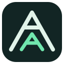

# Ajan Atölyesi

Tek pencereden Pi, Codex ve Claude terminalini aç. **Sadece NVIDIA anahtarın varsa Pi ile başlayabilirsin. Claude, Codex veya bunların abonelikleri şart değil.**

## Claude Code veya Codex ile kur: seç ve kopyala

**[İkisi birden: Pi + NVIDIA ve EVREN + DeepSeek](BASLA.md#pi-ve-evren)** · **[Yalnız Pi + NVIDIA](BASLA.md#pi)** · **[Yalnız EVREN + DeepSeek](BASLA.md#evren)**

Birine tıkla, açılan promptu kopyala ve kendi Claude Code veya Codex terminaline yapıştır. Seçimin prompta yazılı; tekrar seçim yapman gerekmez. Bu araçlar yoksa [manuel kurulum](docs/manuel-kurulum.md) yolunu kullan.

## Sürüm ve değişiklikler

[Sürüm numarası](VERSION) ile [değişiklik günlüğü](CHANGELOG.md) ayrı; **Ajan Atölyesi hakkında** penceresinden veya terminalde `bash bin/ajan-surum` ile bu kopyayı kontrol et. `0.1.0` ilk kararlı 1.0’dan önceki geliştirme çizgisidir. Bir GitHub Release yayımlandığı anlamına gelmez.

**Derleme N**, yalnız bu deponun tam ve temiz Git kopyasında, açık commit’in `master` ana hattındaki sırasıdır. Herkese açık depo temiz geçmişle başlar; sayı bu deponun kendi ana hattına aittir. Kurulum bilinen değeri uygulama klasörüne aktarır. ZIP, sığ klon ve ana hat dışındaki çalışma sayı vermez. Varsa commit kimliği, yoksa **Derleme bilinmiyor** görünür; yerel değişiklikler yayımlanan bir derleme sayılmaz.

## 1. İndir ve kur

**[ZIP indir](https://github.com/OrcunSamiTandogan/ajan-atolyesi/archive/refs/heads/master.zip)**. GitHub hesabı, Git kurulumu veya `git clone` gerekmez.

| Sistem | Kurulum | Doğrulama durumu |
|---|---|---|
| Ubuntu 24.04 | [Linux rehberi](docs/linux.md) | Boş kullanıcı ayarlarından kurulum, uygulama menüsü girdisi ve gömülü terminal doğrulandı. |
| macOS | [Mac rehberi](docs/macos.md) | Homebrew ile kaynaktan oluşturulan `.app` önizleme. Gerçek Mac'te kurulum ve Finder açılışı doğrulanmadı. |
| Windows | [Windows rehberi](docs/windows.md) | WSL 2/WSLg önizleme. Yerel `.exe` yok; gerçek Windows'ta kurulum ve pencere açılışı doğrulanmadı. |

Windows ve macOS kurucularının depoda olması, o sistemlerde çalıştıklarının doğrulandığı anlamına gelmez. [Kabul testleri ve sonuçlar](docs/kalite.md).

**Pi ve DSH’yi birlikte kuracaksan:** Atölye’nin **Terminal** satırından `node -v` ve `npm -v` çalıştır. İkisi de görünmeli; Node.js **24.9+** olmalı. Yalnız Pi için **22.19+** yeterli.

## 2. NVIDIA veya EVREN ile ilk oturumu aç

| Yol | Gerekli anahtar | Atölye’de aç |
|---|---|---|
| **NVIDIA** | **NVIDIA anahtarı** | **Pi · NVIDIA**. Varsayılan MiniMax M3.1 Flash. |
| **EVREN** | **EVREN anahtarı** | Terminal için **EVREN · DSH CLI**, tarayıcı için **EVREN · DSH Web**. DeepSeek V4.1 Flash. |

Yollar bağımsız. Yalnız EVREN’i kullanacaksan NVIDIA anahtarı, yalnız NVIDIA’yı kullanacaksan EVREN anahtarı gerekmez.

### NVIDIA: Pi

1. Atölye'de **NVIDIA anahtarı** → **NVIDIA’da API anahtarı al**. NVIDIA'da oluşturduğun anahtarı maskeli kutuya yapıştır ve **Kaydet**. Daha önce bir anahtar aldıysan yenisini almak zorunda değilsin.
2. Soldaki klasör seçiciden ZIP'ten çıkan **ajan-atolyesi-master** klasörünü seç. İlk denemeyi bu örnek klasörde yap.
3. **Pi · NVIDIA**'ya tıkla. Pi yoksa **Pi’yi kur** düğmesi gelir. Bunun için Node.js 22.19+ ve npm gerekir; ekrandaki [resmî Pi rehberi](https://docs.pi.dev/latest/quickstart) manuel yolu da gösterir. Kurulum bitince **Pi · NVIDIA**'ya tekrar tıkla. Pi, tmux ile `aa-pi` oturumunda açılır. Codex’e açık paneli hedef olarak vermek için **Pi · NVIDIA** satırına sağ tıkla ve **Oturum kimliğini kopyala**'yı seç.
4. Önce `Sadece MERHABA yaz. Dosyalara dokunma.` gönder. Yanıt geldiyse [ilk kodlama görevini](demo/GOREV.md) yap. Yanıt gelmezse [hata ve model değiştirme adımları](docs/sss.md#nvidia-modeli-yavaş-veya-yanıt-vermiyor-ne-yapmalıyım).

**MiniMax M3.1 Flash** varsayılan. **Kimi K3.1 Pro** listede kalır; değiştirmek için `/model` yaz. Alternatif: **Nemotron 3.5 Lightning**. Bunlar cihazına inen modeller değil; istek NVIDIA'ya gider. Atölye’nin anahtarla açtığı Pi’de eklentiler kapalıdır ve başka sağlayıcıların ortam anahtarları Pi’ye devredilmez. Pi’nin yerleşik araçları kullanılabilir. Yine de Pi’nin kendi süreçleri NVIDIA anahtarına erişebilir; yalnız güvendiğin proje klasörünü seç. Kimi ve MiniMax seçimleri doğrulandı. Kısa canlı Nemotron çağrısı geçti; Kimi canlı denemede zaman aşımına uğradı. MiniMax, temiz bir Pi oturumunda kısa canlı denemeye doğru yanıt verdi.

### EVREN: DeepSeek Harness

1. **EVREN anahtarı** düğmesinden EVREN anahtarını maskeli alana kaydet. Projende `.env` oluşturma.
2. **EVREN · DSH CLI** veya **EVREN · DSH Web**’e tıkla. dsh yoksa **dsh’yi kur** düğmesi çıkar. Node.js **24.9+** ve npm gerekir. CLI için tmux ve seçili proje klasörü gerekir.
3. Kurulumdan sonra aynı satırı tekrar aç. CLI’de **DSH >** satırına, Web’de DeepSeek’in resmî mesaj alanına `Sadece MERHABA yaz.` gir. [EVREN kurulum rehberi](docs/evren-dsh.md).

## 3. İstersen diğer oturumları aç

| Düğme | Ne yapar? |
|---|---|
| **Codex oturumu / Claude oturumu** | İlgili komut ayrı kurulmuşsa terminali açar veya `aa-codex` / `aa-claude` oturumuna döner. Yeni oturum normal izinlerle açılır. Hesap geliştirici aracında açılır, Atölye'ye Claude/Codex anahtarı girmen gerekmez. |
| **Codex ile kur / Claude ile kur** | Yeni oturumdan önce **Pi + NVIDIA**, **EVREN + DeepSeek** veya ikisini işaretle. Kurulum promptu yalnız seçtiklerini içerir. Yalnız Atölye’nin tanıdığı normal oturumlara dönülür. Mevcut oturuma kurulum promptu otomatik gönderilmez. |
| **EVREN · DSH CLI** | Resmî **DeepSeek Harness SDK** sürecini `aa-evren-cli` tmux oturumunda açar. Tarayıcı açmaz. **DSH >** satırına mesaj yaz; yanıtın altında bildirilen cache ve token sayaçlarını gör. |
| **EVREN · DSH Web** | Tarayıcıda **resmî DeepSeek Harness** açar. İki yol da aynı dsh kurulumunu ve EVREN’de DeepSeek V4.1 Flash modelini kullanır. [Adımlar](docs/evren-dsh.md) |
| **Terminal** | Uygulama içinde normal kabuk açar. Seçili proje klasöründe, seçim yoksa ev dizininde başlar. Ajan veya tarayıcı açmaz. |
| **Atölye anahtarları (.env)** | Uygulamanın kullandığı gerçek dosyanın konumunu ve her anahtarın kayıt durumunu gösterir. Projede `.env` oluşturma. |

**[Sık sorulan sorular ve sorun giderme](docs/sss.md)** · **[Uygulamasız manuel kurulum: tmux, Pi ve dsh](docs/manuel-kurulum.md)** · **[Katkı rehberi](CONTRIBUTING.md)**

**[Neyi test ettik, ne kaldı?](docs/kalite.md)**

## Lisans

Ajan Atölyesi [MIT lisansıyla](LICENSE) yayımlanır. NVIDIA, EVREN ve diğer dış araçlar kendi lisanslarına ve kullanım koşullarına tabidir.

## Arıza ve geri bildirim

Bir arıza ya da eksik bulursan [issue aç](https://github.com/OrcunSamiTandogan/ajan-atolyesi/issues/new) ya da orcun@tandogan.dev adresine e-posta at. Yazarken sürümünü, işletim sistemini ve ne olduğunu ekle; anahtar, `.env` içeriği veya özel dosya ekleme. Güvenlik açığı bulduysan herkese açık issue yerine [SECURITY.md](SECURITY.md) yolunu kullan.
